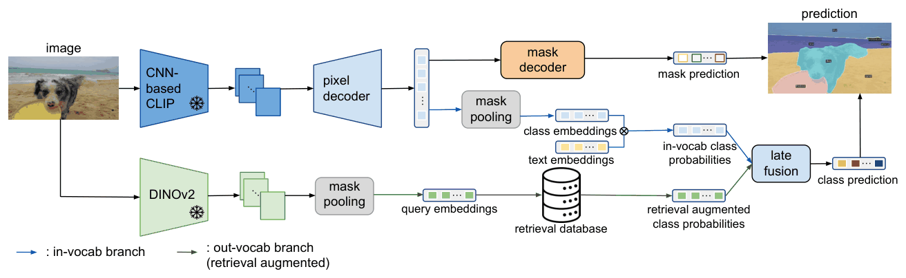

# kNN-CLIP: Retrieval Enables Training-Free Segmentation on Continually Expanding Large Vocabularies

[](https://openreview.net/forum?id=ZSqP1RT8jC)
[](https://arxiv.org/abs/2404.09447)
[](LICENSE)

Zhongrui Gui<sup>1</sup>, Shuyang Sun<sup>1</sup>, Runjia Li<sup>1</sup>, Jianhao Yuan<sup>1</sup>, Zhaochong An<sup>2</sup>, Karsten Roth<sup>3</sup>, Ameya Prabhu<sup>1,3\*</sup>, Philip Torr<sup>1\*</sup>

<sup>1</sup>University of Oxford, <sup>2</sup>University of Copenhagen, <sup>3</sup>University of Tübingen (\*equal advising)

This is the official implementation of kNN-CLIP, built on [FC-CLIP](https://github.com/bytedance/fc-clip).

Continually training an open-vocabulary segmentation model on new classes causes catastrophic forgetting, and the result fails to beat a zero-shot baseline. kNN-CLIP avoids training altogether. It augments the model with a database of instance embeddings and looks up low-confidence predictions in that database at inference time.

- **No training.** New data is added in a single pass with a frozen DINOv2 encoder.
- **Zero forgetting.** Adding embeddings never overwrites what the database already holds.
- **Compact.** Only embeddings are stored, about 6 kB each. No images are kept.
- **Better on large vocabularies.** Over FC-CLIP, mIoU rises by +2.6 on A-847, +1.7 on PC-459 and +7.2 on A-150.

## How it works

<div align="center">
  
</div>

**1. Build the database.** Each training image goes through DINOv2 (ViT-g/14 with 4 registers, "key" features). Images are resized to 518×518, which gives a 1536×37×37 feature map $h_i$. The map is average-pooled over the mask $m'_{ij}$ of each annotated class:

$$e_{ij} = \frac{\sum_{h'}\sum_{w'} (h_i \cdot m'_{ij})}{\sum_{h'}\sum_{w'} m'_{ij}}$$

The embeddings and their labels $c_{ij}$ go into a FAISS index.

**2. Retrieve.** FC-CLIP proposes class-agnostic masks. For each mask, the same pooling on the test image's DINOv2 features gives a query $e_q$, and a kNN search returns the $k$ most similar embeddings with their cosine similarities $s_i$ and labels $c_i$. These become a probability for each class $j$:

$$P_{ret}(j) = \frac{\exp\left(\sum_{i=1}^{k} s_i \cdot \mathbb{I}(c_i = j) + \epsilon\right)}{\sum_{l=1}^{C} \exp\left(\sum_{i=1}^{k} s_i \cdot \mathbb{I}(c_i = l) + \epsilon\right)}$$

**3. Fuse.** Masks that CLIP already classifies confidently keep their prediction. All other masks switch to the weighted retrieval result:

$$P_{final} = \lambda P_{ret} \cdot \left(1 - \mathbb{I}(\max(P_{base}) > T)\right) + P_{base} \cdot \mathbb{I}(\max(P_{base}) > T)$$

$P_{final}$ replaces the out-of-vocabulary class probabilities of FC-CLIP, which then ensembles them with its in-vocabulary classifier as usual.

| Paper | Code |
|---|---|
| Eq. 1, database embeddings | `pool_embeddings` in [build_database.py](build_database.py) |
| Eqs. 2–3, retrieval | `FaissClassifier.compute_class_scores` in [faiss_search.py](fcclip/modeling/retrieval_classification/faiss_search.py) |
| Eq. 4, fusion | `FCCLIP.retrieval_augmentation` in [fcclip.py](fcclip/fcclip.py) |

All benchmarks use $k=16$ and $\lambda=1.2$, the best setting of the ablations on A-847 (Table 6 in the paper). The best $T$ depends on how accurate retrieval is on a dataset (Sec. 4.7 in the paper), so each config sets its own.

## Results

The tables below are from the paper. The base model is FC-CLIP with a ConvNeXt-Large CLIP backbone, trained on COCO Panoptic. For each benchmark, the database is built from that dataset's training set.

**Open-vocabulary semantic segmentation (mIoU)**

| Method | A-847 | PC-459 | A-150 | PC-59 | PC-21 |
|---|---:|---:|---:|---:|---:|
| FC-CLIP | 14.8 | 18.2 | 34.1 | 58.4 | 81.8 |
| kNN-FC-CLIP | **17.4** | **19.9** | **41.3** | **62.8** | **85.3** |
| Δ | +2.6 | +1.7 | +7.2 | +4.4 | +3.5 |

**Open-vocabulary panoptic segmentation**

| Method | ADE20K PQ | ADE20K AP | ADE20K mIoU | COCO PQ | COCO AP | COCO mIoU |
|---|---:|---:|---:|---:|---:|---:|
| FC-CLIP | 26.8 | 16.8 | 34.1 | 54.4 | 44.6 | 63.7 |
| kNN-FC-CLIP | **29.6** | **17.5** | **41.3** | **54.8** | **44.8** | **65.5** |
| Δ | +2.8 | +0.7 | +7.2 | +0.4 | +0.2 | +1.8 |

**Inference speed** on a single A40 GPU, including post-processing

| Method | ADE20K FPS | ADE20K mIoU | COCO FPS | COCO mIoU |
|---|---:|---:|---:|---:|
| FC-CLIP | 2.86 | 34.1 | 2.84 | 63.7 |
| kNN-FC-CLIP, brute force | 1.31 | 41.3 | 0.83 | 65.5 |
| kNN-FC-CLIP, HNSW | 1.52 | 34.2 | 1.51 | 64.5 |

These are the published numbers. The HNSW index that this repository builds reaches the same accuracy as exact search on A-150, see [Approximate search](GETTING_STARTED.md#approximate-search).

## Getting started

Follow [INSTALL.md](INSTALL.md) to set up the environment and [datasets/README.md](datasets/README.md) to prepare the data. Then download the [FC-CLIP ConvNeXt-Large checkpoint](https://drive.google.com/file/d/1-91PIns86vyNaL3CzMmDD39zKGnPMtvj/view?usp=sharing), build a database and evaluate:

```bash
python build_database.py \
  --img_dir $DETECTRON2_DATASETS/ADEChallengeData2016/images/training \
  --mask_dir $DETECTRON2_DATASETS/ADEChallengeData2016/annotations_detectron2/training \
  --out_dir retrieval_db/ade20k

export OMP_NUM_THREADS=4  # your number of physical CPU cores
python train_net.py --eval-only --num-gpus 1 \
  --config-file configs/coco/panoptic-segmentation/fcclip/fcclip_convnext_large_eval_ade20k.yaml \
  MODEL.WEIGHTS /path/to/fcclip_cocopan.pth
```

The first run downloads the DINOv2 weights (4.5 GB) and the CLIP backbone. [GETTING_STARTED.md](GETTING_STARTED.md) has the commands for every benchmark, the options, approximate search, growing a database, the demo and training the base model.

This repository covers kNN-CLIP on FC-CLIP. It does not include the continual training baselines (Tables 1 and 2 in the paper) or the concept customization pipeline of Figure 1, which relies on C2C support sets and EntitySeg masks.

## Citation

```bibtex
@article{gui2024knnclip,
  title   = {{kNN-CLIP}: Retrieval Enables Training-Free Segmentation on Continually Expanding Large Vocabularies},
  author  = {Gui, Zhongrui and Sun, Shuyang and Li, Runjia and Yuan, Jianhao and An, Zhaochong and Roth, Karsten and Prabhu, Ameya and Torr, Philip},
  journal = {Transactions on Machine Learning Research},
  year    = {2024},
  url     = {https://openreview.net/forum?id=ZSqP1RT8jC}
}
```

Please also cite FC-CLIP, which this code builds on:

```bibtex
@inproceedings{yu2023fcclip,
  title     = {Convolutions Die Hard: Open-Vocabulary Segmentation with Single Frozen Convolutional {CLIP}},
  author    = {Yu, Qihang and He, Ju and Deng, Xueqing and Shen, Xiaohui and Chen, Liang-Chieh},
  booktitle = {NeurIPS},
  year      = {2023}
}
```

## Responsible use

kNN-CLIP needs thorough testing and validation before any use in critical applications such as self-driving cars or medical imaging. As stated in the paper, the authors prohibit its use in military or surveillance contexts.

## License and acknowledgements

This repository is released under the [Apache License 2.0](LICENSE). It is derived from [FC-CLIP](https://github.com/bytedance/fc-clip) (Apache 2.0), which builds on [Mask2Former](https://github.com/facebookresearch/Mask2Former) and [ODISE](https://github.com/NVlabs/ODISE). Compared with FC-CLIP, this repository adds `build_database.py`, `fcclip/modeling/retrieval_classification/` and the retrieval path in `fcclip/fcclip.py`, with the related changes to the configs, the demo and the training script. Modified source files say so in their headers.

The DINOv2 model code comes from [facebookresearch/dinov2](https://github.com/facebookresearch/dinov2) (Apache 2.0), its feature wrapper is adapted from [TokenCut](https://github.com/YangtaoWANG95/TokenCut) (MIT), and retrieval uses [FAISS](https://github.com/facebookresearch/faiss).
